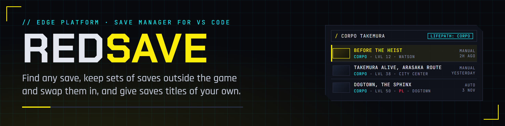
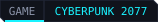

<p align="center">
  
</p>

<p align="center">
  <a href="https://edgemodders.github.io/REDsave/"></a>
  
  
  
  <a href="LICENSE"></a>
</p>

A save game manager for Cyberpunk 2077, as a VS Code extension. Hundreds of saves from several playthroughs, test runs for your mods and the game's own autosaves, kept in order:

- **Find any save** by its title, quest, place, date, lifepath, V's body and voice, level, Street Cred, difficulty, playthrough, game version and Phantom Liberty, with filters and a search box.
- **Loadouts:** keep sets of saves outside the game's save folder, one per playthrough or one for testing a mod, and swap one in before you play. Nothing is deleted.
- **Titles of your own:** "Before the heist, Takemura alive" instead of a quest name.

**[Docs](https://edgemodders.github.io/REDsave/)** &middot; [Design](docs/design.md) &middot; [Changelog](CHANGELOG.md) &middot; [Tests](docs/testing.md)

> [!NOTE]
> **Status: S2a Library and Move built, not released yet.** REDsave 0.0.8 (2026-11-03) finds saves (S1, which passed its hand test on 2026-11-03) and keeps loadouts: sets of saves outside the game's folder, each in its own tab, with saves moved in and out safely (a journal, undo, never while the game runs). It awaits its hand test. Next is S2b, swapping a whole loadout in. The plan and its phases, S0 to S4, are in [docs/design.md](docs/design.md).

## Repo layout

| Folder | What |
|---|---|
| `src/` | The extension: `saves.ts` and `metadata.ts` read the save folder, `index.ts` keeps the index, `search.ts` the search and filters, `names.ts` asks REDbridge for names, `page.ts` the Saves page |
| `webview/`, `media/` | The Saves page's script and styles |
| `test/` | Unit tests, `npm test` |
| `docs/` | The docs site, published at https://edgemodders.github.io/REDsave/ |
| `nexus/` | The Nexus Mods page's source and upload settings |
| `tools/` | `brand/` renders the banner, icon and badges; `release-notes.mjs` and `nexus-zip.mjs` serve the Release workflow; `release/readme-check.mjs` and `nexus/` are shared with the other EDGE repos |

## Build

```powershell
npm install
npm run typecheck
npm run build
npm test
```

Press F5 in VS Code to run it. More in [Dev setup](docs/dev-setup.md).

| You need | Why |
|---|---|
| Windows 10 or 11, Cyberpunk 2077 on PC | REDsave reads the game's save folder |
| VS Code 1.90 or later | REDsave is a VS Code extension |
| REDbridge (optional) | Quest and place names in the player's language; without it REDsave shows the quest's id |

Not affiliated with CD Projekt RED.
